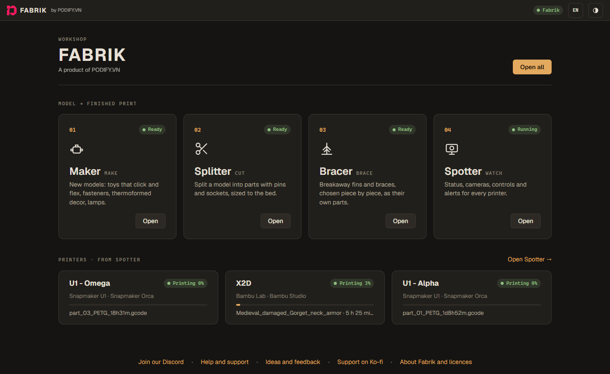
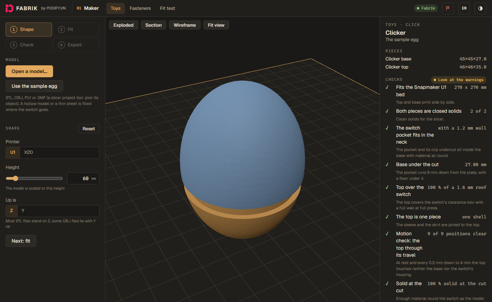
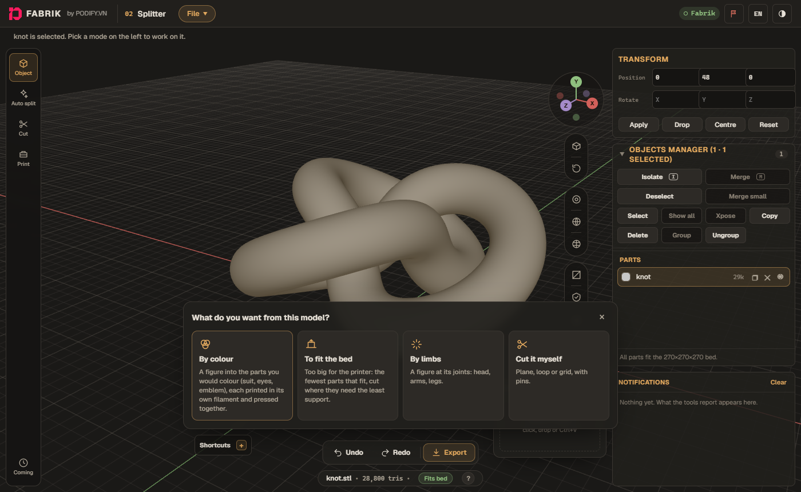
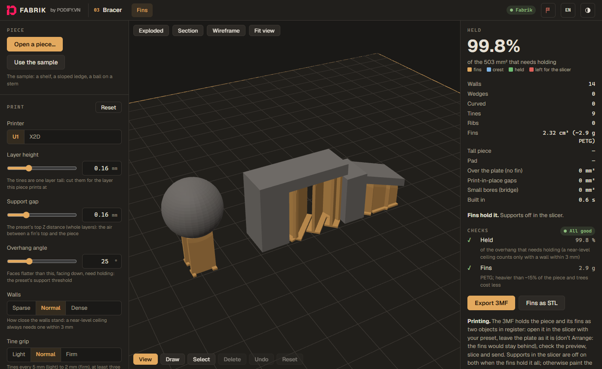
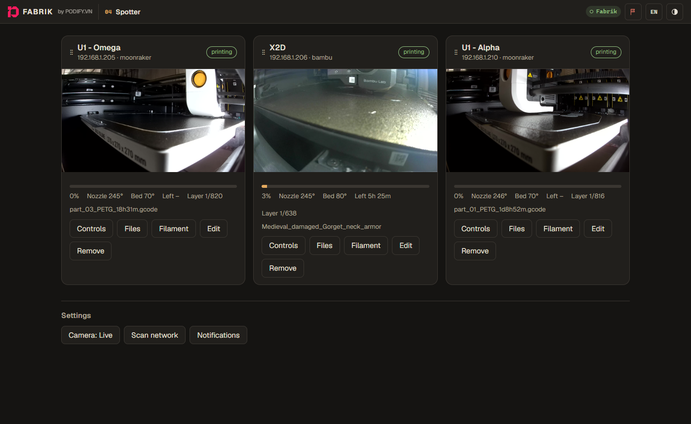

# Fabrik

*[Tiếng Việt](README.md)*

Fabrik is a 3D printing workshop in one window on your PC:

- **Maker** makes new models: click toys, fasteners (bolts, nuts, screws) and more.
- **Splitter** cuts a model that is too big for your printer into parts, with pins and sockets that line them up.
- **Bracer** adds breakaway support fins, as their own part, so a piece prints in its strongest pose.
- **Spotter** watches your printers on your own network: live status and camera, alerts with a photo to your
  Telegram (or email) when a print starts, finishes, fails or gets stuck, and controls (pause, resume, cancel,
  temperatures, light). Nothing goes through a cloud.

Spotter works with **Snapmaker U1** and other **Klipper / Moonraker** printers, and **Bambu Lab** printers in LAN
mode. Windows 10 and 11. Spotter speaks Vietnamese unless switched to English (top right).



| Maker: a click toy from the sample egg | Splitter: what to do with a model |
|---|---|
|  |  |
| **Bracer: support fins on the sample** | **Spotter: three printers, live** |
|  |  |

## Install

1. Download **`Fabrik-<version>-windows.zip`** from the newest release under
   [Releases](../../releases/latest) and unzip it into a folder of its own (for example `Documents\Fabrik`).
   Not Program Files: Fabrik updates itself in its folder.
2. Double-click **`fabrik.exe`**. Windows may say "Windows protected your PC": click **More info → Run anyway**.
   Allow it on the firewall prompt if you want to see Spotter from your phone.
3. Fabrik opens in its own window. Closing the window closes Fabrik, and Spotter stops watching (see
   *Watch the printers all the time* below to keep it watching).
4. Open **Spotter**, click **Scan network** and add your printers.
   - **Bambu Lab:** turn on **LAN only** mode and **developer mode** on the printer, and type its **access code**
     (printer screen, network settings) when you add it. Keep `ffmpeg.exe` beside `fabrik.exe`: the Bambu camera
     needs it.

The settings live in the `data` folder next to `fabrik.exe` (your Telegram token and printer access codes are in
there: don't share that folder).

## Watch the printers all the time (recommended)

So Spotter keeps watching and alerting with the window closed, and from when the PC starts: open a terminal **as
Administrator** in Fabrik's folder and run

```
.\fabrik.exe install
```

Fabrik then runs in the background, and **Fabrik** in the Start menu opens its window. `.\fabrik.exe uninstall`
undoes it (your settings stay). Keep the PC from sleeping (Windows power plan: sleep **Never**), or watching stops.

## Telegram alerts

In Spotter, click **Set up Telegram** on the bar at the top (or **Notifications**) and follow its four steps:

1. **Make a bot:** in Telegram, message [@BotFather](https://t.me/BotFather), send `/newbot`, give it a name, and
   paste the token it sends you. Spotter shows the bot's name when the token is right.
2. **Choose where alerts go:** just you, a group (your family or print buddies), or a channel. **Open Telegram**
   takes you to the right place: press Start in the bot, or pick the group or channel to add the bot to.
3. **Find chats** and pick the one you want.
4. **Send test message**; when it arrives, click **Save**.

The bot token works like a password: don't share it.

## Spotter on your phone

On the same Wi-Fi, open `http://<your PC's name or address>:8700/spotter/` on the phone. Spotter asks for a login
there, so set one first: Spotter → **Notifications** → the username and password at the bottom. The rest of
Fabrik opens only in its window on the PC.

## Updates

Fabrik checks for a new version once a day (switch it off with the version button at the bottom of Fabrik's start page). When one is
out, the start page shows a bar and your alert channel gets one message. Click **What's new**, then **Install**: Fabrik
downloads it, checks it is a genuine release (it is signed), and restarts itself. Installing during a print is fine: the
printer carries on, and Spotter is back watching it a few seconds later. **Check now** in the same place checks straight away.
Every change is listed in [CHANGELOG.md](CHANGELOG.md).

## Something wrong? Report it

Press the **flag** button at the top of any page. Fabrik puts what is needed to fix the problem into one file
(what went wrong on the page, the settings, a picture of the window, Spotter's log; nothing secret) and saves it
in your Downloads, asking first whether to add the model you were working on. Then send that file to Derek by
Telegram, Zalo or email, as the window shows, and say what happened.

You can also ask on our Discord: [join here](https://discord.gg/9CnBKcXFpR), then use [help and support](https://discord.gg/WTEMXyuCCH) for problems and
[ideas and feedback](https://discord.gg/DSAaTC7TqB) for what you would like next.

Fabrik is free. If it helps you, you can [support it on Ko-fi](https://ko-fi.com/dereknguyen).

## If something is wrong

- **No printers found:** the PC and the printers must be on the same network. If they are on another subnet (for
  example the printer is on Wi-Fi and the PC on cable), add it under Notifications → extra subnets, or add the
  printer by its IP address.
- **No alerts:** a VPN can block Telegram; try with the VPN off. **Send test** in Notifications shows the error.
- **"Is Fabrik already running?":** it is (the background service, or another window); the window opens on it.
- **"Fabrik needs Microsoft Edge WebView2":** install the *WebView2 Runtime* from Microsoft (Windows 10 and 11
  usually have it), then open Fabrik again.

`FFMPEG.txt` in the zip says which ffmpeg build is included and where its source is. Fabrik's own licences and
those of the open-source parts in it are under **About Fabrik and licences** at the bottom of its first page.
