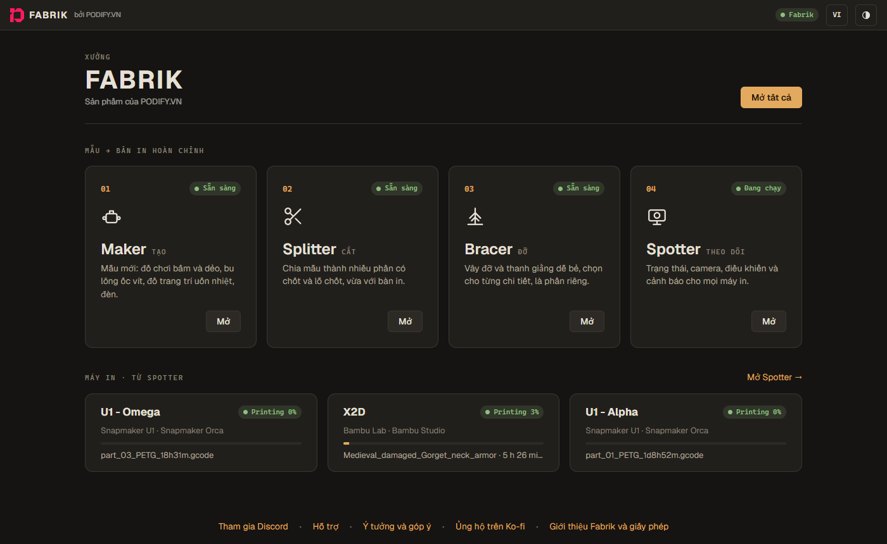
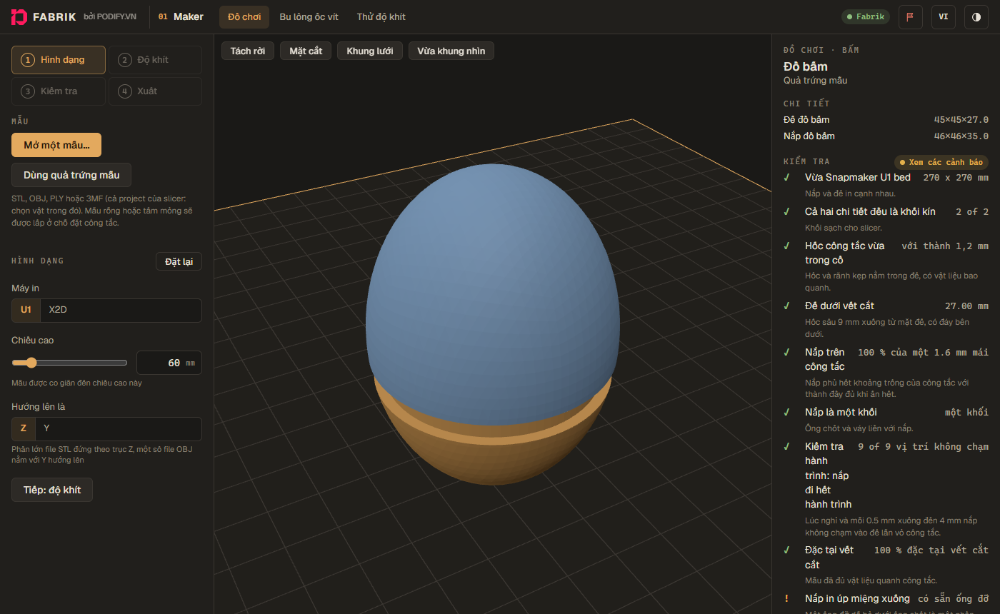
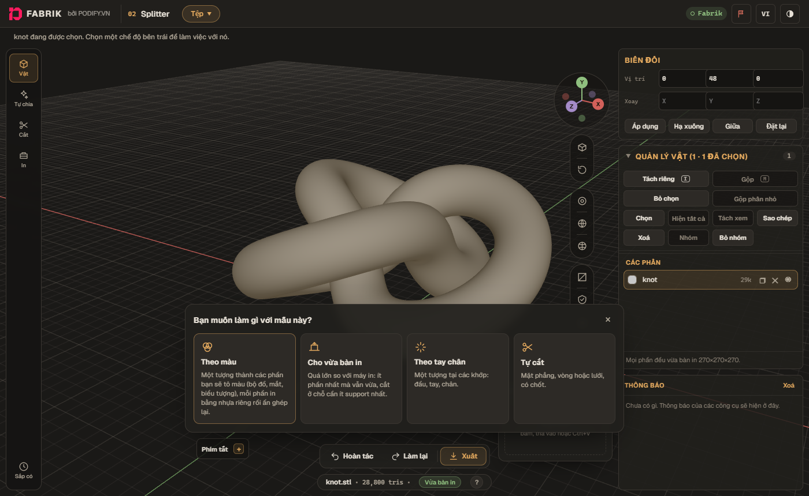
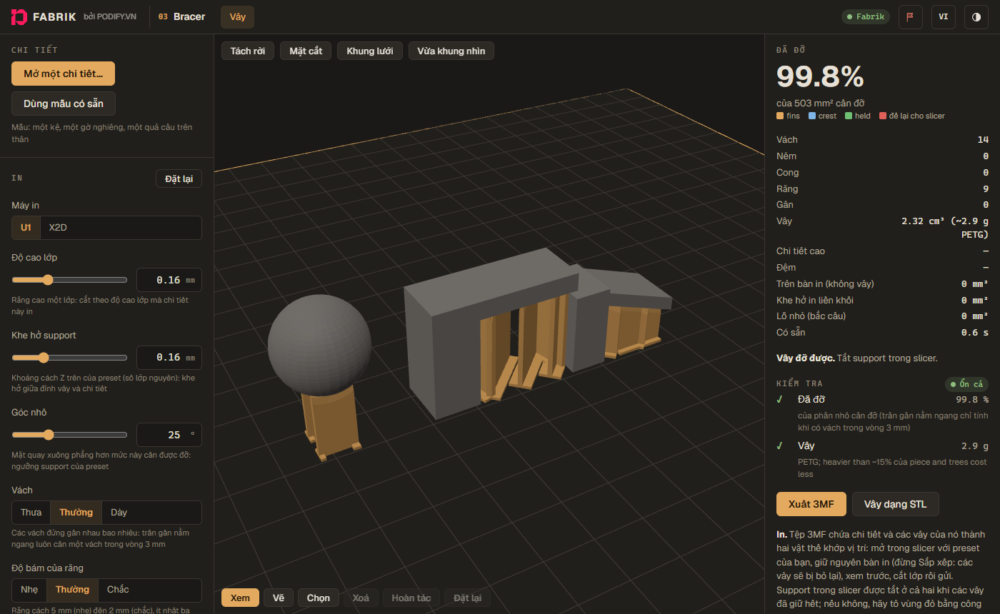
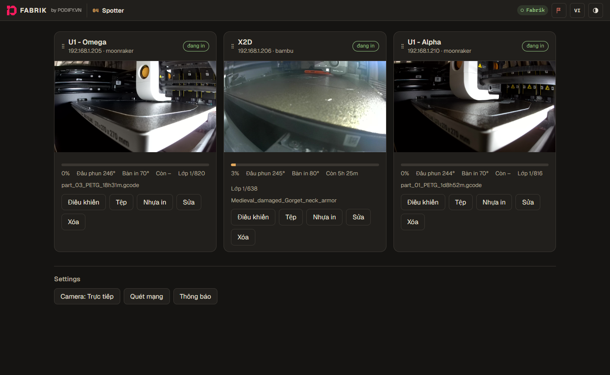

# Fabrik

*[English](README.en.md)*

Fabrik là một xưởng in 3D trong một cửa sổ trên máy tính của bạn:

- **Maker** tạo mô hình mới: đồ chơi bấm click, bu lông, đai ốc, ốc vít và hơn thế nữa.
- **Splitter** cắt mô hình quá lớn so với máy in thành nhiều phần, có chốt và lỗ để ghép thẳng hàng.
- **Bracer** thêm vây đỡ dễ bẻ, thành một phần riêng, để chi tiết được in ở tư thế chắc nhất.
- **Spotter** theo dõi máy in trong mạng nhà bạn: trạng thái và camera trực tiếp, gửi thông báo kèm ảnh qua
  Telegram (hoặc email) khi bản in bắt đầu, in xong, bị lỗi hoặc bị kẹt, và cho phép điều khiển (tạm dừng, tiếp
  tục, hủy, nhiệt độ, đèn). Không qua dịch vụ đám mây nào.

Spotter dùng được với **Snapmaker U1** và các máy **Klipper / Moonraker** khác, và máy **Bambu Lab** ở chế độ LAN.
Chạy trên Windows 10 và 11. Spotter mặc định là tiếng Việt (nút **English** ở góc trên bên phải để đổi).



| Maker: đồ bấm từ quả trứng mẫu | Splitter: chọn cách chia mẫu |
|---|---|
|  |  |
| **Bracer: vây đỡ trên mẫu có sẵn** | **Spotter: ba máy in, trực tiếp** |
|  |  |

## Cài đặt

1. Tải **`Fabrik-<phiên bản>-windows.zip`** ở bản mới nhất trong mục [Releases](../../releases/latest), rồi giải
   nén vào một thư mục riêng (ví dụ `Documents\Fabrik`). Đừng để trong Program Files: Fabrik tự cập nhật ngay
   trong thư mục của nó.
2. Nhấp đúp **`fabrik.exe`**. Nếu Windows báo "Windows protected your PC", bấm **More info → Run anyway**. Khi
   tường lửa hỏi, hãy cho phép nếu bạn muốn xem Spotter từ điện thoại.
3. Fabrik mở trong cửa sổ riêng của nó. Đóng cửa sổ là Fabrik tắt và Spotter ngừng theo dõi (xem mục
   *Theo dõi máy in mọi lúc* bên dưới để nó luôn theo dõi).
4. Mở **Spotter**, bấm **Quét mạng** và thêm máy in của bạn.
   - **Bambu Lab:** bật chế độ **LAN only** và **developer mode** trên máy in, rồi nhập **mã truy cập** (access
     code, xem trong phần cài đặt mạng trên màn hình máy in) khi thêm máy. Giữ `ffmpeg.exe` cạnh `fabrik.exe`:
     camera của Bambu cần nó.

Cài đặt được lưu trong thư mục `data` cạnh `fabrik.exe` (trong đó có token Telegram và mã truy cập máy in: đừng
chia sẻ thư mục này).

## Theo dõi máy in mọi lúc (nên làm)

Để Spotter vẫn theo dõi và gửi thông báo khi đã đóng cửa sổ, và ngay từ lúc bật máy: mở terminal **bằng quyền
Administrator** trong thư mục của Fabrik và chạy

```
.\fabrik.exe install
```

Từ đó Fabrik chạy nền, và mục **Fabrik** trong menu Start mở cửa sổ của nó. `.\fabrik.exe uninstall` để gỡ (cài
đặt của bạn vẫn còn). Đừng để máy tính ngủ (trong cài đặt nguồn của Windows: chế độ ngủ **Never**), nếu không
việc theo dõi sẽ dừng.

## Thông báo qua Telegram

Trong Spotter, bấm **Cài đặt Telegram** trên thanh ở đầu trang (hoặc nút **Thông báo**) và làm theo bốn bước:

1. **Tạo bot:** trong Telegram, nhắn cho [@BotFather](https://t.me/BotFather), gửi `/newbot`, đặt tên cho bot,
   rồi dán token mà nó gửi cho bạn. Spotter hiện tên bot khi token đúng.
2. **Chọn nơi nhận thông báo:** chỉ mình bạn, một nhóm (gia đình hoặc bạn bè cùng in), hoặc một kênh.
   **Mở Telegram** đưa bạn đến đúng chỗ: bấm Start trong bot, hoặc chọn nhóm hay kênh để thêm bot vào.
3. Bấm **Tìm** và chọn cuộc trò chuyện bạn muốn.
4. **Gửi tin nhắn thử**; khi tin nhắn đến, bấm **Lưu**.

Token của bot giống như mật khẩu: đừng chia sẻ nó.

## Xem Spotter trên điện thoại

Cùng mạng Wi-Fi, mở `http://<tên hoặc địa chỉ máy tính>:8700/spotter/` trên điện thoại. Spotter sẽ hỏi tên đăng
nhập, nên hãy đặt trước: Spotter → **Thông báo** → tên đăng nhập và mật khẩu ở cuối. Phần còn lại của Fabrik chỉ
mở trong cửa sổ của nó trên máy tính.

## Cập nhật

Fabrik kiểm tra phiên bản mới mỗi ngày một lần (tắt được bằng nút phiên bản ở cuối trang chủ Fabrik). Khi
có bản mới, trang chủ hiện một thanh thông báo và bạn nhận một tin nhắn. Bấm **Có gì mới**, rồi **Cài đặt**: Fabrik
tải về, kiểm tra đúng là bản phát hành thật (có chữ ký), rồi tự khởi động lại. Cài khi máy đang in cũng được: máy
vẫn in tiếp, vài giây sau Spotter lại theo dõi. **Kiểm tra ngay** ở cùng chỗ để kiểm tra luôn.
Mọi thay đổi có trong [CHANGELOG.md](CHANGELOG.md).

## Gặp lỗi? Hãy báo

Bấm nút **lá cờ** ở đầu bất kỳ trang nào. Fabrik gom những gì cần để sửa lỗi vào một tệp (lỗi trên trang, các cài
đặt, ảnh chụp cửa sổ, nhật ký của Spotter; không có thông tin bí mật) và lưu vào thư mục Tải về, hỏi trước có gửi
kèm mô hình bạn đang làm không. Rồi gửi tệp đó cho Derek qua Telegram, Zalo hoặc email như cửa sổ hướng dẫn, và
kể lại chuyện gì đã xảy ra.

Bạn cũng có thể hỏi trên Discord của mình: [tham gia tại đây](https://discord.gg/9CnBKcXFpR), rồi dùng [hỗ trợ](https://discord.gg/WTEMXyuCCH) khi gặp lỗi và
[ý tưởng và góp ý](https://discord.gg/DSAaTC7TqB) cho những gì bạn muốn có tiếp theo.

Fabrik miễn phí. Nếu thấy hữu ích, bạn có thể [ủng hộ trên Ko-fi](https://ko-fi.com/dereknguyen).

## Khi gặp trục trặc

- **Không tìm thấy máy in:** máy tính và máy in phải cùng một mạng. Nếu khác mạng con (ví dụ máy in dùng Wi-Fi
  còn máy tính cắm dây), thêm mạng con đó trong Thông báo → mạng con cần quét thêm, hoặc thêm máy in bằng địa chỉ
  IP.
- **Không nhận được thông báo:** VPN có thể chặn Telegram; thử tắt VPN. **Gửi thử** trong Thông báo sẽ cho biết
  lỗi.
- **"Is Fabrik already running?":** Fabrik đang chạy rồi (chạy nền hoặc ở cửa sổ khác); cửa sổ sẽ mở trên bản đó.
- **"Fabrik needs Microsoft Edge WebView2":** cài *WebView2 Runtime* của Microsoft (Windows 10 và 11 thường đã
  có sẵn), rồi mở lại Fabrik.

`FFMPEG.txt` trong file zip cho biết bản ffmpeg đi kèm và nơi có mã nguồn của nó. Giấy phép của Fabrik và của các
phần mã nguồn mở bên trong nằm ở mục **About Fabrik and licences** cuối trang đầu tiên.
